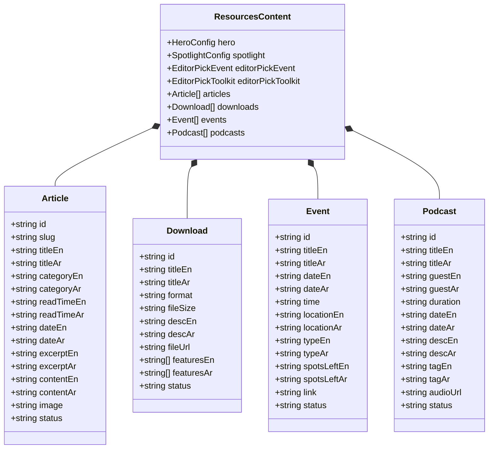

# PontLook Resources — Phase 0: Comprehensive System Inspection Report

**Date**: October 2026  
**Project**: PontLook SaaS (`PontLook-SaaS`)  
**Scope**: Full inspection of existing codebase in preparation for a Payload CMS-driven Resources section  
**Status**: Completed (Read-only inspection; zero destructive operations performed)

---

## 1. Executive Summary

This inspection report establishes the exact architectural baseline of the PontLook SaaS platform before any Payload CMS implementation begins. 

The primary goals of this inspection:
1. Protect existing production architecture, brand identity, and recent mobile performance optimizations (e.g., LCP 2.4s).
2. Document all existing content models, admin interfaces, media handling, and localization layers.
3. Determine compatibility requirements for integrating Payload CMS into Next.js 14.2.15 (App Router) and React 18.3.1.
4. Provide a clear, non-destructive migration roadmap.

---

## 2. Environment, Dependencies & Stack Baseline

| Component | Installed Version | Notes |
| :--- | :--- | :--- |
| **Next.js** | `14.2.15` | App Router (`src/app`), `next.config.mjs` with strict CSP & caching headers. |
| **React / React-DOM** | `18.3.1` | React 18 concurrent features, server components enabled. |
| **TypeScript** | `5.6.2` | Strict mode enabled, `@/*` mapped to `./src/*`, `noEmit: true`. |
| **Payload CMS** | **Not Installed** | Zero Payload packages exist in `package.json` or `node_modules`. |
| **Database Adapter** | **None** | No ORM or database driver (no Postgres, MongoDB, Prisma, Drizzle, etc.). |
| **UI & Styling** | Tailwind `3.4.13` | Custom palette: `#FF5C00`, `#000000`, `#0E0E11`, `#FFFFFF`. |
| **Animation** | Framer Motion `11.11.0`| Configured with `LazyMotion` and dynamic imports for bundle control. |
| **Forms & Validation**| React Hook Form `7.53.0`, Zod `3.23.8` | Used across wizard and intake flows. |
| **Email & Transports**| Nodemailer `10.1.0`, Resend `6.20.0` | Used for contact notifications and admin OTP security codes. |

---

## 3. Existing Resources Subsystem Audit

### 3.1 Current Data Storage Architecture
PontLook currently uses a fast, localized JSON storage engine:
* **Primary Store File**: [`src/data/resources.json`](file:///home/zlouada/Projects/PontLook-SaaS/src/data/resources.json)
* **Backup/Runtime Override**: `/tmp/pontlook-resources.json` (for serverless environments where `process.cwd()` is read-only)
* **Store Manager**: [`src/lib/resources-store.ts`](file:///home/zlouada/Projects/PontLook-SaaS/src/lib/resources-store.ts)
  * Implements `cache()` wrapped `getResourcesStore()`.
  * Implements bidirectional normalization (`titleEn` ↔ `title_en`, etc.).
  * Implements fallback defaults if JSON files are missing or empty.
  * Implements `saveResourcesStore(data)` with cache invalidation.

### 3.2 Content Schemas & Payload Mapping

#### Mapping to Payload CMS:
1. **Hero**: Maps to a Payload Global (`ResourcesHero`).
2. **Spotlight & Editor Picks**: Maps to a Payload Global (`ResourcesFeatured`).
3. **Articles**: Maps to a Payload Collection (`Articles` / `Posts`).
4. **Downloads**: Maps to a Payload Collection (`Downloads` / `Toolkits`).
5. **Events**: Maps to a Payload Collection (`Events`).
6. **Podcasts**: Maps to a Payload Collection (`Podcasts`).
7. **Media**: Maps to a Payload Upload Collection (`Media`).
8. **Users**: Maps to a Payload Auth Collection (`Users`).
9. **Case Studies**: Currently excluded from UI (removed in commit `f7d0e64`). Can be introduced as an optional collection or kept for future phases.

---

## 4. Frontend Routes & Components Audit

### 4.1 Public Routes
All public resource routes live under `src/app/[lang]/resources/`:

* **`/[lang]/resources`** ([`src/app/[lang]/resources/page.tsx`](file:///home/zlouada/Projects/PontLook-SaaS/src/app/[lang]/resources/page.tsx)):
  * Distinct orange header banner (`bg-[#FF5C00]`, rounded bottom `rounded-b-[48px]`).
  * Category navigation pills (All Resources, Blog, Events, Downloads, Podcasts).
  * 8-column Spotlight card + 4-column 2-card stack (Event pick + Toolkit pick).
  * Corporate L&D Blog preview grid (3 latest articles).
  * Executive Events preview grid (3 upcoming events).
  * Monthly L&D newsletter subscription block.
* **`/[lang]/resources/blog`** ([`src/app/[lang]/resources/blog/page.tsx`](file:///home/zlouada/Projects/PontLook-SaaS/src/app/[lang]/resources/blog/page.tsx)):
  * Thought leadership listing with breadcrumbs, category pills, publication dates, and author attribution.
* **`/[lang]/resources/blog/[slug]`** ([`src/app/[lang]/resources/blog/[slug]/page.tsx`](file:///home/zlouada/Projects/PontLook-SaaS/src/app/[lang]/resources/blog/[slug]/page.tsx)):
  * Full article reader supporting bilingual markdown rendering (`prose`), featured image, lead excerpt, and corporate training matchmaking CTA.
* **`/[lang]/resources/downloads`** ([`src/app/[lang]/resources/downloads/page.tsx`](file:///home/zlouada/Projects/PontLook-SaaS/src/app/[lang]/resources/downloads/page.tsx)):
  * Grid of downloadable spreadsheets (TNA matrices, RFP templates) with feature bullet points.
* **`/[lang]/resources/events`** ([`src/app/[lang]/resources/events/page.tsx`](file:///home/zlouada/Projects/PontLook-SaaS/src/app/[lang]/resources/events/page.tsx)):
  * Executive roundtables, webinars, and summits with location, time, badge, and RSVP link.
* **`/[lang]/resources/podcasts`** ([`src/app/[lang]/resources/podcasts/page.tsx`](file:///home/zlouada/Projects/PontLook-SaaS/src/app/[lang]/resources/podcasts/page.tsx)):
  * Executive interviews with guest bio, duration, and audio stream links.

### 4.2 Navigation Integration
* **Desktop & Mobile Navbar** ([`src/components/layout/Navbar.tsx`](file:///home/zlouada/Projects/PontLook-SaaS/src/components/layout/Navbar.tsx)):
  * Includes a 3-column GoodHabitz-style mega-menu under the "Resources" item:
    * Column 1: Resources Hub Overview link.
    * Column 2: Direct links to Blog, Events, Downloads, Podcasts.
    * Column 3: Featured highlight card.

---

## 5. Media, Security & Authentication Audit

### 5.1 Media Handling
* **API Endpoints**:
  * `POST /api/admin/upload`: Handles multipart form file uploads up to 15 MB (PNG, JPG, WebP, SVG, AVIF, GIF).
  * `GET /api/admin/media`: Lists assets sorted by recency.
  * `DELETE /api/admin/media?filename=...`: Deletes file from disk.
* **Public Asset Serving**:
  * `GET /uploads/[...file]` ([`src/app/uploads/[...file]/route.ts`](file:///home/zlouada/Projects/PontLook-SaaS/src/app/uploads/[...file]/route.ts)) streams assets from `public/uploads` or `/tmp/pontlook-uploads` with 1-year immutable caching headers and directory traversal protection.

### 5.2 Admin Authentication
* **Security Module**: [`src/lib/admin-auth.ts`](file:///home/zlouada/Projects/PontLook-SaaS/src/lib/admin-auth.ts)
* **Email Whitelist**: Restricts admin access to authorized corporate addresses (`contact@pontlook.com`).
* **2FA OTP**: Dispatches a 6-digit verification code (10-minute expiry) via Hostinger SMTP, with fallbacks to Resend and Web3Forms.
* **Sessions**: Signed HMAC-SHA256 session tokens stored in `httpOnly`, `secure`, `sameSite="lax"` cookie `pontlook_admin_session` with 7-day rolling expiry.

---

## 6. SEO, Localization & Performance Audit

### 6.1 Localization
* Configured in [`src/i18n/config.ts`](file:///home/zlouada/Projects/PontLook-SaaS/src/i18n/config.ts):
  * Supported locales: `en` (default) and `ar`.
  * Middleware [`src/middleware.ts`](file:///home/zlouada/Projects/PontLook-SaaS/src/middleware.ts) handles automatic prefixing and redirects legacy regional URLs (`/sa`, `/ae`, `/ar-ae`) to canonical language paths.
  * Field-level bilingual storage (`*En` and `*Ar`) matches Payload's native localization capabilities.

### 6.2 SEO
* Alternates generated via `constructAlternates(lang, path)` covering `en`, `ar`, and `x-default`.
* JSON-LD schemas in [`src/lib/seo/schema.ts`](file:///home/zlouada/Projects/PontLook-SaaS/src/lib/seo/schema.ts).
* Dynamic XML Sitemap in [`src/app/sitemap.ts`](file:///home/zlouada/Projects/PontLook-SaaS/src/app/sitemap.ts).

### 6.3 Performance Guardrails
* The recent performance initiative reduced mobile LCP from 5.2s to 2.4s and purged over 510 KB of client bundle bloat caused by external CMS client subscribers (see `PERF_REPORT.md`).
* **Payload Architecture Requirement**: Payload must run purely on the server (Local API / Server Components) without polluting the public frontend client bundle with heavy admin UI or client SDKs.

---

## 7. The 8 Core Determinations

### 1. What already exists
* Fully styled, responsive, bilingual public frontend for all resource categories.
* Defined domain data schemas for Hero, Featured Picks, Articles, Downloads, Events, Podcasts, and Media.
* Standalone custom `/admin` CMS with OTP authentication and media manager.
* Seed content in `src/data/resources.json`.

### 2. What can be reused
* **100% of the UI design and components**: All frontend JSX, Tailwind classes, and Framer Motion components in `src/app/[lang]/resources/**`.
* **Field structures**: All existing property names map directly to Payload fields.
* **The `/uploads/[...file]` streaming route**: Can serve uploaded assets seamlessly.
* **Existing SEO generators and XML sitemap logic**.

### 3. What is missing
* Payload CMS dependencies (`@payloadcms/next`, `@payloadcms/richtext-lexical`, and database adapter).
* Database instance (PostgreSQL, MongoDB, or SQLite).
* `src/payload.config.ts`.
* Collection and Global configuration files.
* Generated types (`payload-types.ts`).
* Environment variables: `PAYLOAD_SECRET` and `DATABASE_URI`.

### 4. Which files should be modified
* `package.json`: Add approved Payload packages and scripts.
* `next.config.mjs`: Wrap with `withPayload`.
* `src/middleware.ts`: Add route exclusion for Payload admin/api paths.
* `src/app/[lang]/resources/**`: Connect data fetching to Payload Local API (`payload.find`, `payload.findGlobal`).
* `src/app/sitemap.ts`: Query Payload for dynamic article URLs.

### 5. Which files should be created
* `src/payload.config.ts`: Core configuration.
* `src/payload/collections/Articles.ts`
* `src/payload/collections/Downloads.ts`
* `src/payload/collections/Events.ts`
* `src/payload/collections/Podcasts.ts`
* `src/payload/collections/Media.ts`
* `src/payload/collections/Users.ts`
* `src/payload/globals/ResourcesHero.ts`
* `src/payload/globals/ResourcesFeatured.ts`
* `src/app/(payload)/admin/[[...segments]]/page.tsx`: Payload Admin view.
* `src/app/(payload)/api/[...slug]/route.ts`: Payload REST API endpoint.
* `src/lib/payload.ts`: Server-cached Payload client with JSON fallback safeguard.

### 6. Migration of existing resources functionality
* Existing content from `src/data/resources.json` (hero text, spotlight benchmarks, editor picks) must be seeded into the database during initialization.
* A fallback adapter in `src/lib/payload.ts` should guarantee that if the database is unreachable or empty, the frontend seamlessly renders `src/data/resources.json`.

### 7. Existing database migrations
* **None**. No database migrations exist in the repository.

### 8. Available commands
* Development: `npm run dev`
* Lint: `npm run lint`
* Typecheck: `npx tsc --noEmit`
* Tests: None currently configured
* Build: `npm run build`
* Deploy: `npm run deploy`
* Payload Type Generation: (Will be added as `npm run generate:types`)
* Migrations: (Will be added according to chosen adapter)

---

## 8. Phased Implementation Roadmap

1. **Phase 1: Architecture & Dependency Alignment**
   * Finalize database selection (e.g., PostgreSQL via Supabase/Neon, or MongoDB Atlas, or SQLite).
   * Review exact Payload 3.x packages compatible with Next.js 14.2.15.
2. **Phase 2: Payload Core Installation & Config**
   * Install approved packages.
   * Create `payload.config.ts` and set up environment variables.
3. **Phase 3: Collections & Globals Definitions**
   * Define `Articles`, `Downloads`, `Events`, `Podcasts`, `Media`, `Users`.
   * Define Globals for Hero and Featured cards.
   * Generate TypeScript definitions.
4. **Phase 4: Admin & API Route Mounting**
   * Mount Payload Admin under `(payload)` route group.
5. **Phase 5: Data Seeding & Migration**
   * Seed database from `src/data/resources.json`.
6. **Phase 6: Frontend Integration**
   * Connect `src/app/[lang]/resources/**` to Payload Local API with fallback safeguard.
7. **Phase 7: End-to-End Build & Verification**
   * Verify lint, typecheck, static page generation, and bundle size.
